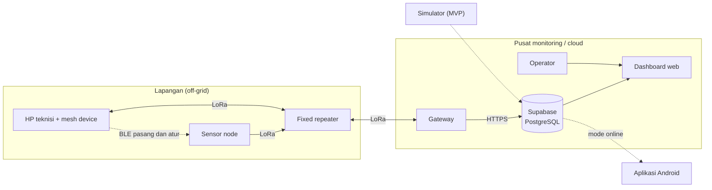

# EnviMesh

**Sistem pemantauan muka air tanah gambut berbasis LoRa mesh, tanpa sinyal seluler.**

Sensor di lahan gambut mengukur tinggi muka air secara otomatis, mengirim datanya secara estafet
lewat jaringan radio LoRa ke pusat monitoring, lalu sistem memberi peringatan dini sebelum gambut
cukup kering untuk terbakar.

> Proyek mahasiswa bersama **Yayasan Svarga Bhumi Nusantara (SBN)** · November 2026 – Januari 2027
> Status: **MVP dalam pengembangan** (simulasi software, hardware menyusul)

---

## Daftar isi

- [Latar belakang](#latar-belakang)
- [Solusi](#solusi)
- [Arsitektur sistem](#arsitektur-sistem)
- [Fitur dan use case](#fitur-dan-use-case)
- [Status pengembangan](#status-pengembangan)
- [Teknologi](#teknologi)
- [Struktur repository](#struktur-repository)
- [Memulai](#memulai)
- [Skenario demo](#skenario-demo)
- [Keamanan](#keamanan)
- [Roadmap](#roadmap)
- [Referensi](#referensi)

---

## Latar belakang

Gambut aman selama basah. Ketika muka air tanah turun, gambut mengering dan mudah terbakar, dan
apinya bisa menjalar di bawah permukaan sehingga sulit dipadamkan. Karena itu, **tinggi muka air
tanah** adalah indikator utama risiko kebakaran gambut. Regulasi pemerintah (PP 57/2016) bahkan
menyatakan lahan gambut rusak bila muka air tanahnya lebih dari 0,4 m di bawah permukaan.

Masalah di lapangan:

- **Tidak ada sinyal seluler** di sebagian besar area gambut, jadi data tidak bisa dikirim lewat internet biasa.
- **Pengukuran masih manual.** Petugas harus mendatangi tiap titik, sehingga data jarang dan terlambat.
- **Solusi satelit mahal.** Contohnya, pelacak satelit BKSDA untuk konflik gajah dihentikan karena biayanya tinggi.
- **Koordinasi tim pemadam sulit** saat terjadi kebakaran di area tanpa sinyal.

## Solusi

EnviMesh memakai perangkat **LoRa** yang saling meneruskan data (**topologi mesh**), sehingga data
dari sensor di tengah hutan tetap sampai ke pusat tanpa jaringan seluler dan tanpa biaya satelit.

1. **Sensor node** bangun tiap 30 menit, mengukur muka air, kelembapan tanah, suhu, dan kelembapan udara, lalu tidur lagi untuk menghemat baterai.
2. Data dikirim **estafet** lewat node lain dan **repeater** sampai ke **gateway** di pusat monitoring.
3. **Server** menyimpan data dan otomatis membuat **alert** bila muka air melewati batas.
4. **Operator** memantau di **dashboard web** dan dapat mengirim lokasi kejadian **balik** lewat mesh ke **HP teknisi** di lapangan.

Keunggulan: open source, tanpa izin frekuensi khusus, tanpa biaya penyedia satelit, dan data
di-host di infrastruktur sendiri.

## Arsitektur sistem



| Lapisan | Komponen | Peran |
| --- | --- | --- |
| Lapangan | Sensor node, fixed repeater, mesh device teknisi | Mengukur dan meneruskan data lewat LoRa mesh (MeshCore) |
| Jaringan | Gateway | Menjembatani LoRa mesh ke internet |
| Server | Supabase (PostgreSQL, Data API, Realtime) | Menyimpan data, cek threshold, membuat alert |
| Pengguna | Dashboard web, aplikasi Android | Pemantauan, penanganan alert, pemasangan node |

Ambang batas default (bisa diubah per node):

| Status | Kedalaman muka air di bawah permukaan | Dasar |
| --- | --- | --- |
| Aman | < 40 cm | |
| Waspada (`warning`) | ≥ 40 cm | Kriteria kerusakan gambut, PP 57/2016 |
| Bahaya (`danger`) | ≥ 50 cm | Studi gambut Sumatra Selatan: ± 0,5 m memicu kebakaran membara |

## Fitur dan use case

| ID | Use case | Aktor |
| --- | --- | --- |
| UC-01 | Mengukur dan mengirim data sensor | Sensor node |
| UC-02 | Menerima, menyimpan, dan mengecek threshold | Gateway, server |
| UC-03 | Memantau peta dan status node (termasuk node offline) | Operator |
| UC-04 | Menangani alert dan mengirim lokasi ke teknisi | Operator, teknisi |
| UC-05 | Melihat riwayat dan membuat laporan (PDF/Excel) | Operator |
| UC-06 | Memasang dan mengonfigurasi node lewat Bluetooth | Teknisi |

## Status pengembangan

| Bagian | Status | Keterangan |
| --- | --- | --- |
| Database (Supabase) | ✅ Selesai | Tabel, trigger alert otomatis, view status node, aturan akses, Realtime |
| Simulator data | ✅ Selesai | 5 node virtual dengan skenario kering, stabil, error, dan offline |
| Aplikasi Android | 🟡 Berjalan | UI 8 layar, peta GPS, mode online dari Supabase, notifikasi alert |
| Dashboard web | 🟡 Dikerjakan | Peta, grafik tren, daftar alert live, export |
| Integrasi BLE ↔ MeshCore | ⏳ Rencana | Menunggu unit LoRa dari SBN |
| Hardware sensor node | ⏳ Rencana | Pemilihan sensor selesai, perakitan menyusul |

Sensor yang dipilih untuk prototipe:

| Parameter | Sensor | Alasan |
| --- | --- | --- |
| Muka air | A02YYUW (ultrasonik, tahan air) | 3,3 V, hemat daya, blind zone kecil (3 cm) |
| Kelembapan tanah | Capacitive soil moisture v2.0 | Tidak berkarat seperti sensor resistif |
| Suhu dan kelembapan udara | SHT40 | Akurat, hemat daya, didukung langsung oleh MeshCore |
| Suhu tanah | DS18B20 (probe tahan air) | Pendukung deteksi api di bawah permukaan |

## Teknologi

| Bagian | Teknologi |
| --- | --- |
| Jaringan lapangan | LoRa (AS923), MeshCore |
| Database dan API | Supabase: PostgreSQL, Data API (REST), Realtime |
| Aplikasi Android | Kotlin, Jetpack Compose, osmdroid (OpenStreetMap) |
| Simulator | Python 3 (library standar saja) |
| Dashboard | Web, terhubung ke Supabase |

## Struktur repository

```
EnviMesh/
├─ app/            Aplikasi Android (Kotlin + Jetpack Compose) — panduan: app/README.md
├─ database/       Skema Supabase: 01_schema.sql (tabel, trigger, view, akses), 02_test.sql
├─ simulator/      Simulator node virtual (Python) — panduan: simulator/README.md
├─ dashboard/      Dashboard web (dalam pengerjaan)
├─ gradle/         Gradle wrapper
└─ README.md       Dokumen ini
```

## Memulai

### 1. Database (Supabase)

1. Buat proyek di [supabase.com](https://supabase.com) (region Singapore).
2. Buka **SQL Editor**, jalankan isi `database/01_schema.sql`.
3. (Opsional) jalankan `database/02_test.sql` untuk uji cepat; hasil akhirnya harus `sensor_error`.

### 2. Simulator

```bash
cd simulator
# buat file .env berisi SUPABASE_URL dan SUPABASE_SECRET_KEY (lihat simulator/README.md)
python simulator.py --once     # tes satu putaran
python simulator.py            # jalan terus, Ctrl+C untuk berhenti
python simulator.py --reset    # hapus data simulasi
```

### 3. Aplikasi Android

1. Buka folder root repo di Android Studio.
2. Tambahkan ke `local.properties` (tidak ikut ke GitHub):
   ```
   supabase.url=https://<project-ref>.supabase.co
   supabase.publishableKey=sb_publishable_xxxx
   ```
3. Sync Gradle, lalu Run ▶ ke HP Android. Detail: [`app/README.md`](app/README.md).

### 4. Dashboard web

Lihat folder `dashboard/` (menyusul).

## Skenario demo

1. `python simulator.py --reset`, lalu `python simulator.py` (set `SIM_TICK_SECONDS=5` untuk demo cepat).
2. Buka aplikasi Android atau dashboard: lima node muncul dengan status masing-masing.
3. Node-01 mengering perlahan: alert **warning** (≥ 40 cm), lalu **danger** (≥ 50 cm), dan notifikasi muncul di HP.
4. Node-05 berhenti mengirim data dan berubah jadi **offline**; Node-04 sesekali melaporkan **sensor error**.
5. Operator menandai alert sebagai ditangani; waktu respons tercatat dan bisa diekspor sebagai laporan.

## Keamanan

- **Publishable key** (`sb_publishable_…`) boleh dipakai di aplikasi dan dashboard: aturan database hanya mengizinkannya **membaca**.
- **Secret key** (`sb_secret_…`) hanya untuk simulator atau gateway di server, disimpan di `.env`, dan **tidak pernah** di-commit.
- Perubahan status alert hanya bisa dilakukan oleh operator yang login (Supabase Auth).
- File `.env` dan `local.properties` sudah masuk `.gitignore`.

## Roadmap

- [x] Rancangan sistem, use case, dan diagram arsitektur
- [x] Database dengan alert otomatis
- [x] Simulator data
- [x] Aplikasi Android: UI, peta GPS, mode online, notifikasi
- [ ] Dashboard web dengan update live dan login operator
- [ ] Replay dataset muka air gambut asli di simulator
- [ ] Integrasi BLE aplikasi ↔ MeshCore companion
- [ ] Gateway: meneruskan data LoRa ke Supabase
- [ ] Perakitan dan uji lapangan sensor node

## Referensi

- Peraturan Pemerintah No. 57 Tahun 2016 tentang Perlindungan dan Pengelolaan Ekosistem Gambut.
- [Spatiotemporal variations of soil moisture and groundwater level in a south Sumatra peatland, 2015–2018](https://hazeportal.asean.org/?p=14035)
- [Taufik dkk. (2022), dataset kedalaman air tanah gambut harian, Batanghari dan Kubu Raya](https://hazeportal.asean.org/?p=12602)
- [MeshCore companion protocol](https://docs.meshcore.io/companion_protocol/)
- [Supabase documentation](https://supabase.com/docs)
